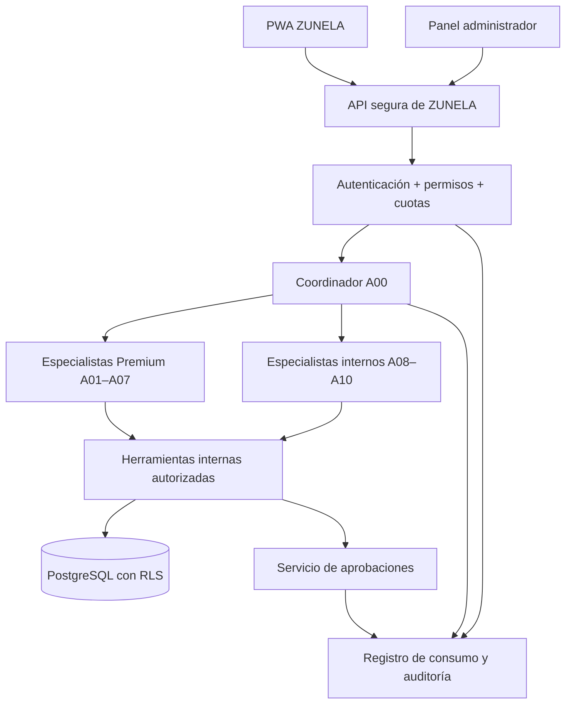

# ZUNELA — Documento Maestro del Producto

**Versión 1.1 · Actualización de arquitectura con agentes OpenAI**  
**Fecha:** 5 de noviembre de 2026  
**Estado:** Documento de planificación; funciones de IA propuestas, no implementadas  
**Lema de trabajo:** *Conecta con tu gente.*

**Plataforma de afinidades, oportunidades y comunidades**

> **PROPÓSITO:** Ayudar a las personas a encontrar aliados, conocimientos, comunidades y oportunidades compatibles con sus intereses y objetivos.

Alcance inicial: Colombia \| Producto: plataforma web instalable (PWA) \| Estado: definición funcional

Nombre de trabajo: ZUNELA (con Z). Pendiente verificación jurídica, dominio y presencia comercial.

*Documento de referencia para análisis, diseño, desarrollo y validación del MVP.*

**Documento base:** ZUNELA — Documento Maestro v1.0, 31 de octubre de 2026. Esta revisión conserva el alcance funcional original y agrega capacidades de IA con implementación gradual.

# Control del documento

| **Campo**                     | **Definición**                                                      |
|-------------------------------|---------------------------------------------------------------------|
| Proyecto                      | ZUNELA — Conexiones por afinidad, oportunidades y comunidades       |
| Versión                       | 1.1 — Arquitectura de agentes OpenAI y acceso Premium/administración |
| Estado                        | Plan maestro actualizado; agentes planificados, no desarrollados    |
| Cobertura                     | Colombia inicialmente; evolución internacional y multilingüe        |
| Canal principal               | Aplicación web responsive / PWA                                     |
| Nombre comercial              | ZUNELA, provisional, sujeto a revisión de marcas y dominios         |
| Modelo                        | Freemium + prueba Premium de 10 días + suscripción mensual/anual    |
| Objetivo de la primera prueba | Validar con una comunidad piloto de aproximadamente 50–100 usuarios |

## Historial de versiones

| Versión | Fecha | Alcance |
|---|---|---|
| 1.0 | 31/10/2026 | Definición funcional de ZUNELA: perfiles, afinidad, oportunidades, comunidades, match, seguridad, planes y MVP. |
| 1.1 | 05/11/2026 | Incorporación de agentes OpenAI para usuarios Premium y administración; orquestación, permisos, herramientas, auditoría, costos, fases y criterios de aceptación. |

## Decisiones ya aprobadas

- La plataforma cubre negocios, conocimientos, actividades y hobbies, con orientación comercial y profesional.

- Los usuarios descubren perfiles, oportunidades y comunidades; el vínculo entre personas requiere interés y aceptación recíprocos.

- El usuario gratuito participa en oportunidades preexistentes; la creación de oportunidades propias es Premium.

- Las comunidades pueden ser públicas, privadas o por invitación; las dos últimas corresponden a Premium.

- El usuario gratuito tendrá un cupo parametrizable para crear comunidades públicas; Premium contempla creación ilimitada sujeta a controles de abuso.

- Los datos de contacto estarán ocultos; su intercambio requiere permiso explícito del titular y acceso según plan.

- La verificación de identidad/facial es opcional y se distingue de la reputación.

- El asistente y la búsqueda avanzada con IA son funciones Premium previstas para una fase posterior al MVP.

- Se incorporará una **arquitectura de agentes OpenAI** de manera gradual: funciones de IA para cuentas Premium y agentes operativos para el equipo administrador, con controles independientes por rol, plan, consentimiento y permisos.

- Las decisiones críticas y las operaciones con efectos sobre terceros o datos sensibles requieren controles deterministas y, cuando corresponda, aprobación humana; el agente no reemplaza el sistema de autorización.

## Aspectos todavía configurables o pendientes

Tarifas finales, cupos, límites de chat, política de moderación detallada, umbrales de afinidad, proveedor de pago, proveedor biométrico y condiciones definitivas del programa de prueba. **Nuevas decisiones pendientes:** presupuestos de IA, cuotas por plan, modelos OpenAI por tarea, política de retención de conversaciones con IA, autorización de herramientas y secuencia de lanzamiento de cada agente.

# 1. Visión estratégica

## 1.1 Problema que resuelve

Encontrar a la persona correcta para un objetivo concreto suele depender de grupos dispersos, contactos personales y publicaciones poco estructuradas. ZUNELA organiza intenciones, capacidades e intereses para facilitar descubrimiento y colaboración con reglas claras de confianza.

## 1.2 Propuesta de valor

ZUNELA permite decir “qué busco”, “qué puedo aportar” y “con quién quiero conectar”. A partir de esa información, recomienda perfiles, oportunidades existentes y comunidades relacionadas; posteriormente propondrá círculos basados en coincidencias significativas.

## 1.3 Principios de producto

- Objetivo antes que popularidad: priorizar coincidencias útiles, no solo interacción superficial.

- Comunidad además de persona: la unidad de valor incluye círculos, comunidades y oportunidades.

- Consentimiento y privacidad por diseño, sin presión para divulgar contactos.

- Crecimiento gradual: primero validar la interacción núcleo; después pagar, IA y expansión internacional.

- Reglas transparentes de reputación, moderación y beneficios Premium.

# 2. Público objetivo y casos de uso

Usuarios iniciales: emprendedores, vendedores, networkers, empresarios, profesionales, estudiantes, personas que buscan ingresos adicionales y cualquier persona interesada en colaborar, aprender o realizar actividades grupales.

| **Caso**      | **Ejemplo de intención**                                      | **Resultado deseado**              |
|---------------|---------------------------------------------------------------|------------------------------------|
| Socios        | “Busco persona con habilidades comerciales para mi proyecto.” | Match y conversación               |
| Equipos       | “Quiero integrarme a un equipo de ventas.”                    | Unirse a oportunidad existente     |
| Conocimiento  | “Busco comunidad para aprender IA aplicada a negocios.”       | Comunidad y recursos               |
| Colaboradores | “Necesito apoyo con diseño, tecnología o mercadeo.”           | Coincidencia por complementariedad |
| Actividad     | “Quiero organizar senderismo con personas afines.”            | Círculo o comunidad                |
| Mentoría      | “Quiero encontrar profesionales que compartan experiencia.”   | Contacto consensuado               |

La experiencia inicial será nacional en Colombia, con filtros por ciudad, departamento, remoto o alcance nacional. La expansión posterior incorporará idiomas, zonas horarias, moneda y normas locales.

# 3. Experiencia principal del usuario

## 3.1 Recorrido del MVP

1. Registro y aceptación de políticas.

2. Configuración del perfil: nombre visible, foto, profesión, ciudad y privacidad.

3. Selección de intereses, objetivos, habilidades, ofertas y disponibilidad.

4. Descubrimiento de personas, comunidades públicas y oportunidades del catálogo.

5. Expresión de interés y aceptación recíproca para abrir un match individual.

6. Entrada a comunidades según visibilidad y reglas; conversaciones internas con moderación.

7. Evaluación de la experiencia, reportes y seguimiento de actividad.

## 3.2 Perfil de afinidad

Campos propuestos: identificador interno, nombre legal protegido, nombre público configurable, foto o avatar, profesión, ciudad, país, presentación, intereses, objetivos (busco), aportes (ofrezco), conocimientos, habilidades, modalidad presencial/remota, alcance geográfico y preferencias de notificación.

La visibilidad se controla por campo y contexto: perfil público, antes del match, después del match y datos compartidos expresamente. Teléfono y correo no se muestran por defecto.

## 3.3 Descubrimiento

La interfaz permitirá buscar por categorías, explorar tarjetas y filtrar por ubicación, intereses, tipo de objetivo y modalidad. Las recomendaciones mostrarán razones comprensibles: “comparten dos intereses” o “sus habilidades se complementan”.

# 4. Roles y permisos

| **Rol**         | **Responsabilidades**                                                                                                                   |
|-----------------|-----------------------------------------------------------------------------------------------------------------------------------------|
| Visitante       | Conocer presentación pública; registrarse; sin acceso a datos privados.                                                                 |
| Usuario Gratis  | Descubrir, solicitar match, entrar a oportunidades del catálogo, crear comunidades públicas dentro de cuota, conversar con límites.     |
| Usuario Premium | Beneficios Gratis + crear oportunidades propias, comunidades privadas/por invitación, límites ampliados, IA Premium cuando esté activa. |
| Moderador       | Gestionar reportes y contenidos de acuerdo con privilegios específicos y registro de acciones.                                          |
| Administrador   | Configurar catálogos, planes, límites, reglas, seguridad, parámetros, auditoría y agentes administrativos según privilegios.           |

## 4.1 Matriz comercial de acceso propuesta

| **Capacidad**                          | **Gratis**         | **Premium**               |
|----------------------------------------|--------------------|---------------------------|
| Perfil, intereses y descubrimiento     | Sí                 | Sí                        |
| Match recíproco                        | Sí                 | Sí                        |
| Participar en oportunidades existentes | Sí                 | Sí                        |
| Crear una oportunidad propia           | No                 | Sí                        |
| Crear comunidades públicas             | Cuota configurable | Sin cupo comercial fijo\* |
| Comunidades privadas/por invitación    | No                 | Sí                        |
| Chat interno                           | Con límites        | Límites ampliados         |
| Compartir datos externos               | No                 | Con permiso del titular   |
| Recomendaciones básicas                | Sí                 | Sí                        |
| Búsqueda/asistencia avanzada de IA     | No                 | Sí, cuando se habilite    |
| Copiloto de perfil y objetivos         | No                 | Sí, con cuota de IA       |
| Match explicado con IA                 | No                 | Sí, con datos autorizados |
| Asistente de oportunidades             | No                 | Sí, con revisión humana   |
| Copiloto de comunidades y networking   | No                 | Sí, según permisos        |
| Traducción inteligente                 | No                 | Sí, fase internacional    |

**Nota:** “Sin cupo comercial fijo” no exime de límites técnicos, prevención de abuso y restricciones por seguridad. La tabla es una configuración inicial, modificable por el panel. El acceso a IA estará condicionado además por disponibilidad, saldo/cuota, políticas de uso y consentimiento cuando corresponda. La prueba Premium de 10 días podrá incluir una cuota de IA limitada **solo cuando el módulo esté activo**.

## 4.2 Acceso administrativo a agentes

- **Administrador de plataforma:** acceso a agentes de analítica, moderación y operaciones conforme a privilegios granulares, autenticación reforzada y auditoría; **no** equivale a acceso indiscriminado a mensajes privados o datos de contacto.
- **Moderador:** únicamente asistencia en reportes y revisión de contenido autorizado para el caso asignado; sin acceso al agente de configuración o a métricas personales no necesarias.
- **Usuario Premium:** agentes orientados a su propio perfil, oportunidades y comunidades, dentro de su plan y de los permisos concedidos por terceros.
- **Usuario Gratis:** conserva las funciones tradicionales; no se le promete IA generativa, salvo futuras promociones explícitamente configuradas.
- Los permisos administrativos se asignan por función (RBAC/ABAC), no simplemente por pertenecer a la categoría «administrador».

# 5. Módulos funcionales

## M01 — Identidad y acceso

Registro, autenticación, recuperación de acceso, permisos, consentimiento, cierre de sesión y eliminación/desactivación de cuenta.

## M02 — Perfiles e intereses

Campos visibles/privados, fotos, intereses múltiples, habilidades, objetivos, ciudad, disponibilidad y preferencias.

## M03 — Motor de afinidad

Puntuación explicable y recomendaciones por coincidencia y complementariedad; filtros y límites para evitar duplicados.

## M04 — Match y conexiones

Interés/solicitud, aceptación, rechazo, retiro, bloqueo, historial y notificaciones; chat individual después del match.

## M05 — Oportunidades

Catálogo administrado, categorías, fichas, filtros, postulaciones/interés, propietarios Premium y estados de moderación.

## M06 — Comunidades y círculos

Comunidad pública/privada/por invitación, roles, cupos, solicitud de acceso, publicación y chat; sugerencias de círculo posteriores.

## M07 — Mensajería y moderación

Chats individuales y comunitarios, restricción de contactos/enlaces, reportes, bloqueo, rate limiting y registro de incidentes.

## M08 — Reputación y verificación

Calificaciones justificadas, antigüedad, comportamiento, indicadores verificables, verificación opcional y apelaciones.

## M09 — Planes y pagos

Prueba Premium, cuotas parametrizables, suscripción mensual/anual, renovaciones, cambios de plan, cancelación y comprobantes.

## M10 — Administración y analítica

Catálogo de intereses, parámetros, moderación, usuarios, oportunidades, métricas y bitácora de cambios.

## M11 — Plataforma de agentes OpenAI (planificada)

Orquestador de IA y especialistas para perfil, afinidad, oportunidades, comunidades, networking, conocimiento, traducción, moderación, analítica y operaciones. Los agentes consumen herramientas del backend bajo permisos y cuotas, sin acceso directo a la base de datos ni autorización para acciones sensibles por sí mismos. Detalle completo en los capítulos 16–28.

## M12 — Gobierno, facturación y observabilidad de IA (planificado)

Habilitación por rol/plan, cupos, presupuestos, límites de tokens y llamadas, trazabilidad, aprobaciones, pruebas de seguridad, evaluaciones y apagado de emergencia del módulo de IA.

# 6. Reglas de negocio

- RB-01: un usuario puede elegir varios intereses, objetivos y habilidades; el catálogo es administrable y ampliable.

- RB-02: un match individual se confirma cuando ambas partes expresan interés o aceptan la solicitud; ningún match habilita por sí solo divulgación de datos privados.

- RB-03: el usuario Gratis podrá seleccionar o participar en oportunidades existentes, pero no publicar oportunidades propias.

- RB-04: la publicación de nuevas oportunidades requiere plan Premium activo y moderación de contenido cuando corresponda.

- RB-05: el usuario Gratis creará comunidades públicas con cupo por período configurable; el valor inicial se decidirá antes de programar.

- RB-06: comunidades privadas y por invitación requieren permiso Premium; las comunidades públicas estarán sujetas a normas generales.

- RB-07: Premium contempla comunidades sin límite comercial predeterminado, sujetas a límites de seguridad, calidad y uso justo.

- RB-08: teléfono, correo, identificadores sociales y enlaces estarán restringidos en chats según reglas administrables; la moderación no garantiza detección perfecta.

- RB-09: compartir un contacto externo requiere consentimiento afirmativo del titular, aceptación explícita de la contraparte y elegibilidad según plan; se permitirá revocarlo.

- RB-10: la calificación de reputación no penalizará automáticamente al usuario por no usar verificación biométrica.

- RB-11: la insignia “Identidad verificada” solo aparecerá tras completar satisfactoriamente el método aprobado.

- RB-12: al terminar los 10 días de prueba, sin suscripción elegida, la cuenta volverá a Gratis sin cargo automático.

- RB-13: todas las cuotas, límites, planes y umbrales se administrarán por parámetros versionados y auditables.

- RB-14: en cada comunidad los usuarios podrán reportar contenido, bloquear personas y apelar decisiones según políticas.

- RB-15: se evitará recomendar comunidades privadas o datos de miembros sin respetar permisos y visibilidad.

- RB-16: las recomendaciones de círculos serán propuestas optativas, no grupos privados creados automáticamente con personas no consentidoras.

- RB-17: los agentes Premium solo se ejecutan si el usuario tiene derecho vigente, cuota disponible y el agente está habilitado para su plan y región.
- RB-18: los agentes administrativos requieren rol, privilegio específico, autenticación reforzada cuando aplique y auditoría.
- RB-19: ningún agente podrá revelar contactos, chats privados, perfiles ocultos ni membresías privadas sin autorización válida del titular y de la política de acceso.
- RB-20: las herramientas ejecutan validaciones de autorización en el backend en cada llamada, independientemente de las instrucciones del modelo.
- RB-21: enviar invitaciones, publicar contenido, crear oportunidades, suspender cuentas, modificar configuraciones o ejecutar campañas exige confirmación o aprobación según su nivel de riesgo.
- RB-22: la IA no crea un match, no ingresa usuarios a comunidades ni comparte datos externos sin los consentimientos y acciones exigidos por las reglas vigentes.
- RB-23: las recomendaciones generadas por IA deben ser explicables y no presentarse como garantía de éxito, ingresos o compatibilidad.
- RB-24: la prueba Premium no genera cargos automáticos al vencer; la cuota de IA de prueba es limitada y revocable por abuso.
- RB-25: el sistema aplicará presupuestos máximos, límites de velocidad y apagado de emergencia de IA por usuario, agente y globalmente.
- RB-26: los textos de perfiles, mensajes y oportunidades son datos no confiables; ninguna instrucción contenida en ellos puede elevar permisos o activar herramientas.
- RB-27: toda decisión adversa relevante apoyada por IA (por ejemplo, suspensión o eliminación de contenido) contará con intervención humana o revisión/apelación conforme a la política aplicable.
- RB-28: el acceso a conversaciones o información de terceros por parte de administradores se limitará a motivos legítimos, permisos expresos y trazabilidad.
- RB-29: toda acción con efecto externo deberá ser idempotente cuando sea posible y registrar actor, autorización, aprobación, resultado y correlación de ejecución.

# 7. Afinidad, match y círculos

## 7.1 Puntuación inicial (hipótesis de diseño)

Modelo de reglas simple, auditable y sin IA generativa en el MVP. La puntuación preliminar puede ponderar intereses compartidos (30 %), compatibilidad de objetivos (30 %), habilidades complementarias (20 %), modalidad/alcance (15 %) y disponibilidad (5 %). Los pesos son experimentales y se ajustarán tras medir resultados.

No debe interpretarse como probabilidad objetiva de éxito comercial o personal. La interfaz explicará por qué se recomienda una coincidencia.

## 7.2 Ciclo de match

Estados sugeridos: sugerido → interés enviado → interés mutuo / aceptado → conexión activa → bloqueado, rechazado o cerrado. Una invitación expirada no debe reactivarse sin nueva acción.

## 7.3 Círculos sugeridos (posterior)

El sistema agrupará señales anónimas de compatibilidad por objetivo, categoría o ubicación, y sugerirá crear un círculo si hay usuarios elegibles suficientes. Cada persona elegirá entrar; no se revelará información de terceros durante la sugerencia.

# 8. Privacidad, confianza y moderación

## 8.1 Datos personales y controles

- Minimización: pedir solo los datos necesarios para el servicio y justificar cada campo.

- Roles y permisos de lectura: no exponer correo/teléfono en las respuestas del servidor si el usuario no tiene autorización.

- Preferencias por campo: nombre visible, fotografía, profesión, ciudad, intereses y contactos.

- Seguridad: contraseña con proveedor confiable, autenticación robusta, sesiones con expiración, cifrado en tránsito y control de accesos.

- Derechos del titular: acceso, corrección, retiro del consentimiento, desactivación y solicitudes de eliminación según normativa aplicable.

- Retención: períodos documentados por categoría; especial atención a chat, denuncias, registros de seguridad y documentos de verificación.

## 8.2 Verificación de identidad

La verificación facial será opcional y debe implementarse únicamente después de evaluar necesidad, proporcionalidad, alternativa no biométrica, proveedor, consentimiento específico y protección de datos sensibles. No retener biometría directamente si no es necesario.

## 8.3 Contenido comercial sensible

Se admitirán categorías como multinivel, venta directa, afiliados, inmobiliario y oportunidades comerciales bajo reglas de transparencia. Se prohibirá el fraude, la suplantación, el spam, las promesas engañosas de ingresos y las solicitudes abusivas. Las ofertas de inversión deberán pasar controles legales y de moderación adicionales antes de habilitarse.

Se realizarán revisiones legales específicas para Colombia antes del lanzamiento comercial, particularmente en protección de datos, consumo digital, publicidad, pagos recurrentes y operación de servicios intermediados.

# 9. Modelo conceptual de datos

| **Entidad**                    | **Campos orientativos y relaciones**                                                   |
|--------------------------------|----------------------------------------------------------------------------------------|
| Usuario / Perfil               | usuario_id, nombre_legal, nombre_visible, ciudad, profesión, flags_visibilidad, estado |
| Interés / Habilidad / Objetivo | catálogo_id, nombre, categoría, activo; relaciones N:M con perfil                      |
| Oportunidad                    | oportunidad_id, creador_id, categoría, título, descripción, tipo, estado, visibilidad  |
| Participación en oportunidad   | usuario_id, oportunidad_id, rol_interés, estado, fecha                                 |
| Comunidad                      | comunidad_id, creador_id, tipo_acceso, reglas, cupo, estado                            |
| Miembro de comunidad           | usuario_id, comunidad_id, rol, estado, fecha                                           |
| Conexión / Match               | usuarios vinculados, interés de cada parte, estado, fecha                              |
| Mensaje / Conversación         | conversación_id, autor_id, tipo, texto permitido, moderación, fecha                    |
| Plan / Suscripción             | plan_id, suscripción_id, periodo, estado, prueba, proveedor, fechas                    |
| Calificación / Verificación    | autor, destinatario, evento validado, estado, método opcional                          |
| Reporte / Auditoría            | actor, objetivo, categoría, decisión, timestamp, motivo                                |
| Configuración                  | clave, valor, ámbito, vigencia, modificador, historial                                 |
| Definición de agente          | agente_id, versión, propósito, estado, capacidades, nivel_riesgo                       |
| Política de acceso a IA       | agente_id, plan, rol, privilegio, región, estado, vigencia                             |
| Ejecución de IA               | ejecución_id, actor_id, agente_id, estado, correlación, duración, modelo               |
| Consumo de IA                 | ejecución_id, tokens_entrada/salida, costo_estimado, período, presupuesto              |
| Solicitud de aprobación       | solicitud_id, acción, parámetros_resumidos, solicitante, aprobador, vencimiento        |
| Consentimiento de IA          | usuario_id, finalidad, versión_texto, estado, fecha, revocación                        |
| Evaluación/Incidente IA       | evaluación_id, versión_agente, categoría, resultado, revisión, medidas                 |

Modelo de alto nivel; la base de datos definitiva requiere normalización, claves, índices, política de borrado y controles de acceso a nivel de fila.

# 10. Arquitectura tecnológica propuesta

Candidata inicial: aplicación web responsive/PWA con Next.js, backend de servicios y PostgreSQL; Supabase u otra solución gestionada puede acelerar autenticación, almacenamiento y mensajes en tiempo real. La decisión definitiva depende de costos, residencia de datos, políticas de seguridad y operación.

- Frontend PWA: registro, perfil, descubrimiento, match, comunidad, mensajes, suscripción y administración.

- Backend/API: autorizaciones por rol y plan, parámetros, reglas de match, moderación y registro auditable.

- Base de datos relacional: perfiles, catálogos, comunidades, conexiones, planes, reportes.

- Tiempo real: chat con permisos antes de entregar mensajes y límites por usuario.

- Archivos: fotografías, evidencias y medios sujetos a acceso y retención.

- Servicios futuros desacoplados: pasarela de pagos, proveedor de verificación e IA.

- **Capa de IA del servidor:** SDK de agentes OpenAI para TypeScript (`@openai/agents`) o servicio aislado equivalente; ejecución exclusiva desde backend seguro, nunca desde el navegador.
- **API de herramientas internas:** funciones de lectura/escritura acotadas que validan identidad, rol, plan, consentimiento, propiedad del recurso y políticas de la acción antes de consultar PostgreSQL.
- **Orquestación:** agente coordinador con especialistas invocados como herramientas; flujos deterministas para tareas sensibles y aprobación humana donde corresponda.
- **Servicios de soporte:** cola de trabajos para tareas diferidas, observabilidad con redacción de datos, control de costos, repositorio de prompts versionados y evaluaciones automatizadas.
- **Dependencia externa:** API de OpenAI con claves guardadas únicamente en secretos del servidor; política de contingencia si el proveedor no responde.

## 10.1 Requisitos no funcionales

- Disponible en móvil y escritorio; accesibilidad básica y buena conectividad en redes móviles.

- Alto nivel de privacidad: ninguna filtración de datos restringidos por endpoints, búsquedas o logs.

- Respaldos automatizados y restauración probada antes del piloto abierto.

- Telemetría sin contenido sensible en registros de actividad.

- Versionado de configuraciones y documentación de cambios.

- Preparación para varios idiomas desde el modelo y la interfaz, aunque el MVP salga en español.

# 11. Pantallas esenciales del MVP y ampliaciones posteriores

| **Pantalla**                   | **Función principal**                                       |
|--------------------------------|-------------------------------------------------------------|
| 01\. Bienvenida / acceso       | Explicar valor, registro, ingreso y consentimiento.         |
| 02\. Configuración de perfil   | Foto, nombre público, ciudad, profesión, privacidad.        |
| 03\. Mis intereses / objetivos | Selección múltiple, búsqueda y preferencias.                |
| 04\. Descubrir                 | Tarjetas de personas, oportunidades, comunidades y filtros. |
| 05\. Perfil público            | Información autorizada y botón de interés.                  |
| 06\. Detalle de oportunidad    | Categoría, objetivo, creador, reglas y participación.       |
| 07\. Comunidades               | Exploración, miembros, acceso, publicaciones y chat.        |
| 08\. Mis matches               | Solicitudes, aceptaciones y conexiones vigentes.            |
| 09\. Mensajes                  | Chat sujeto a permisos, reportes y límites.                 |
| 10\. Mi cuenta                 | Notificaciones, privacidad, seguridad y membresía.          |
| 11\. Administración            | Usuarios, catálogos, reportes y parámetros.                 |
| 12\. Centro IA Premium         | **Fase 2+**: chat de asistencia, sugerencias explicadas, historial y cuota. |
| 13\. Copiloto de oportunidades | **Fase 2+**: redacción guiada, validaciones y borradores aprobables. |
| 14\. Panel de agentes admin    | **Fase 2+**: moderación asistida, analítica, trabajos y aprobaciones. |
| 15\. Control de IA             | **Fase 2+**: consumo, límites, permisos, versiones y auditoría. |

# 12. Hoja de ruta de desarrollo

| **Fase**              | **Entregables**                                                                                           | **Validación**                                 |
|-----------------------|-----------------------------------------------------------------------------------------------------------|------------------------------------------------|
| Fase 0 — Diseño       | Nombre provisional, reglas, prototipos, modelo de datos, matriz de permisos y diseño seguro de agentes.  | Flujos revisados y backlog priorizado.         |
| Fase 1 — MVP          | Perfiles, afinidad básica, match, oportunidades, comunidades públicas, chat, admin y puntos de extensión IA (apagados). | Piloto controlado 50–100 usuarios sin depender de IA. |
| Fase 2 — Negocio      | Planes, prueba 10 días, pagos, comunidades privadas y publicaciones Premium; beta de 2–3 agentes si pasa controles. | Conversión, cobros, calidad y límites de IA. |
| Fase 3 — Confianza/IA | Reputación, verificación opcional, expansión de agentes Premium y administrativos, círculos sugeridos.    | Adopción, precisión, seguridad y costo por usuario. |
| Fase 4 — Global       | Idiomas, traducción, monedas y regiones.                                                                  | Prueba en nuevo mercado.                       |

## 12.1 Métricas piloto

- Activación: porcentaje que completa perfil e intereses.

- Descubrimiento útil: usuarios que ven al menos una recomendación relevante.

- Match: tasa de interés recíproco y tiempo hasta primera conexión.

- Conversación: porcentaje de matches que intercambian mensajes válidos.

- Retención: regreso de usuarios a 7 y 30 días.

- Seguridad: reportes por usuarios activos, tiempos de atención y reincidencia.

- Futuro negocio: conversión de prueba, cancelaciones, ingresos y costo de IA.
- IA: usuarios Premium activos que usan agentes, utilidad percibida, tasa de tareas completadas, errores, latencia p95, costo por conversación y por usuario, aprobaciones rechazadas y eventos de seguridad.

# 13. Criterios mínimos de aceptación del MVP

- Un usuario puede registrarse y completar intereses/objetivos sin revelar información de contacto a terceros.

- Un usuario puede descubrir perfiles relevantes y verificar explicaciones de afinidad.

- Ninguna conversación privada se abre sin el estado de conexión exigido por la regla de match.

- El usuario Gratis puede participar en una oportunidad del catálogo pero no crear una nueva.

- Las cuotas de comunidades públicas se respetan incluso frente a intentos de acceso directo a API.

- El chat aplica reglas configurables, bloquea lo detectado y comunica los motivos; las incidencias pueden reportarse.

- El administrador puede suspender un usuario, moderar contenido, modificar parámetros y revisar auditoría.

- Los datos privados no aparecen por búsquedas públicas, perfil ajeno, APIs o notificaciones.

- Existe procedimiento de recuperación, bloqueo, eliminación y respaldo verificable.

- El piloto puede medirse con eventos de producto sin almacenar innecesariamente el contenido de las conversaciones.
- Si se activa una beta de IA, ningún usuario Gratis puede invocar herramientas Premium por API, ningún agente puede revelar datos ocultos y el administrador puede suspender agentes y revisar consumo.
- Toda operación con efectos externos sometida a aprobación falla de forma segura si falta permiso, si la aprobación vence o si el servicio de IA falla.

# 14. Decisiones pendientes priorizadas

| **Prioridad** | **Decisión**                       | **Propuesta inicial**                                                                      |
|---------------|------------------------------------|--------------------------------------------------------------------------------------------|
| Alta          | Identidad de marca                 | ZUNELA provisional; consulta marcaria y dominios antes de registro.                        |
| Alta          | Cuota Gratis de comunidades        | Configurable: sugerencia inicial 1–2 por período.                                          |
| Alta          | Activación de oportunidad Gratis   | Participar/manifestar interés; definir si puede ofrecer un rol o habilidad dentro de ella. |
| Alta          | Qué hace visible el perfil         | Nombre público y ciudad; resto por controles de privacidad.                                |
| Alta          | Condiciones de chat                | Definir límites diarios, tipos de adjuntos y umbrales de moderación.                       |
| Alta          | Reglas de consentimiento contactos | Acceso solo con autorización explícita, registro y revocación.                             |
| Media         | Precios y suscripciones            | Determinar tarifa después de medir valor y costos.                                         |
| Media         | Reputación                         | Definir eventos calificables, reportes y mecanismos anti-manipulación.                     |
| Alta          | IA Premium y administración         | Aprobar catálogo inicial, permisos, límites, aprobaciones, evaluación y costos.            |
| Media         | Verificación opcional              | Diseñar procedimiento legal/técnico independiente del MVP.                                 |

# 15. Próximas acciones

1. Validar el nombre ZUNELA mediante investigación jurídica y comercial en los territorios prioritarios.

2. Cerrar parámetros de Gratis/Premium, términos de prueba y reglas de comunicación.

3. Producir historias de usuario y diagramas de interacción para cada módulo del MVP.

4. Diseñar wireframes de registro, perfil, descubrimiento, match, oportunidad y comunidad.

5. Aprobar el modelo lógico de datos, políticas de autorización y estructura base de la aplicación.

6. Implementar primero autenticación, perfiles e intereses; luego descubrimiento y match.

7. Realizar pruebas internas y piloto acotado antes de monetizar o implementar IA avanzada.

8. Preparar las interfaces seguras para herramientas de IA sin habilitarlas públicamente en el MVP.

9. Priorizar la beta de agentes de perfil, oportunidades y afinidad; validar calidad, seguridad y costo antes de escalar.

10. Habilitar agentes administrativos por separado, empezando por analítica agregada y asistencia a moderadores, con aprobación humana.

## Glosario breve

Afinidad: coincidencia de intereses/objetivos. Match: conexión aceptada por ambas partes. Oportunidad: propuesta de colaboración. Comunidad: espacio de interacción con reglas. Círculo: pequeño grupo afín. PWA: aplicación web instalable.

---

# 16. Ampliación estratégica: agentes OpenAI

## 16.1 Decisión de producto

ZUNELA incorporará agentes basados en modelos y herramientas de OpenAI como **capacidades integradas en su propia PWA**, no como una obligación de que los usuarios tengan cuenta o suscripción personal de ChatGPT. La operación utilizará la API correspondiente y sus costos serán asumidos y administrados por ZUNELA según el modelo comercial que se defina.

**Estado de esta decisión:** incorporación al alcance planificado **aprobada**. Los nombres, cuotas y prioridades de cada agente de este capítulo son **propuestas de implementación sujetas a validación**. No se declara ninguna integración como ya desarrollada.

## 16.2 Objetivos concretos

1. Reducir la fricción para crear perfiles útiles, describir objetivos y descubrir colaboradores.
2. Ayudar a convertir intereses compartidos en oportunidades y comunidades reales.
3. Mejorar la calidad y la pertinencia de las conexiones, sin reemplazar el consentimiento recíproco.
4. Dar herramientas Premium diferenciadoras con valor percibido y costos controlables.
5. Asistir a los administradores en moderación, análisis y operación sin conceder autonomía irrestricta.
6. Preparar la expansión multilingüe sin comprometer privacidad, seguridad ni sostenibilidad.

## 16.3 Principios no negociables

- **IA como copiloto, no autoridad:** propone, resume, redacta y analiza; la plataforma y las personas autorizadas deciden.
- **Acceso mínimo necesario:** cada agente recibe solo los datos pertinentes y permitidos para la tarea.
- **Herramientas de alcance cerrado:** un agente no consulta tablas arbitrarias, no ejecuta SQL libre ni puede ampliar sus privilegios.
- **Control humano:** las acciones públicas, comerciales, disciplinarias o sobre terceros exigen confirmación/aprobación según el riesgo.
- **Transparencia:** indicar al usuario que interactúa con IA, mostrar el origen de las recomendaciones y permitir corregir errores.
- **No dependencia en el núcleo:** perfiles, match, comunidades, chat y moderación básica deben seguir funcionando si OpenAI no está disponible.

# 17. Catálogo propuesto de agentes

Se propone **un coordinador y diez agentes especialistas**. No es necesario construirlos todos desde el principio: se habilitarán por fases y cada uno tendrá herramientas, permisos, métricas y presupuestos propios.

| Código | Agente | Destinatario | Valor principal | Fase propuesta |
|---|---|---|---|---|
| A00 | Coordinador ZUNELA | Premium / administrador | Entender intención, elegir especialista y aplicar política de acceso | Fase 2 |
| A01 | Copiloto de perfil y objetivos | Premium | Mejorar presentación, intereses, habilidades y metas | Fase 2 |
| A02 | Afinidad y match inteligente | Premium | Buscar coincidencias elegibles y explicar complementariedad | Fase 2–3 |
| A03 | Asistente de oportunidades | Premium | Crear borradores, estructurar ofertas y sugerir mejoras | Fase 2 |
| A04 | Gestor de comunidades y círculos | Premium | Proponer temas, reglas, actividades y grupos optativos | Fase 3 |
| A05 | Copiloto de networking | Premium | Preparar mensajes, presentaciones y planes de colaboración | Fase 3 |
| A06 | Orientador de conocimiento | Premium | Sugerir recursos, rutas de aprendizaje y comunidades pertinentes | Fase 3 |
| A07 | Traducción y comunicación global | Premium | Traducir contenido autorizado y apoyar conversaciones multilingües | Fase 4 |
| A08 | Asistente de confianza y moderación | Moderador / administrador | Clasificar reportes, detectar riesgos y proponer decisiones | Fase 2–3 |
| A09 | Analista gerencial | Administrador autorizado | Consultar métricas agregadas, detectar tendencias y producir informes | Fase 2–3 |
| A10 | Copiloto de operaciones y configuración | Administrador autorizado | Diagnosticar incidencias y preparar cambios con aprobación | Fase 3 |

## 17.1 A00 — Coordinador ZUNELA

- **Entrada:** intención del usuario y contexto mínimo autorizado (identidad técnica, plan, rol, idioma, agente habilitado).
- **Funciones:** clasificar la solicitud, comprobar elegibilidad antes de invocar un especialista, decidir si la tarea requiere datos, confirmación o aprobación, consolidar la respuesta.
- **Herramientas:** `get_ai_entitlements`, `get_agent_catalog`, `create_ai_run`, `request_approval`.
- **Restricciones:** no modifica datos de negocio por sí mismo; no sustituye la verificación del backend; no transmite historial completo a especialistas si no es necesario.
- **Salida:** respuesta clara, agente utilizado, referencias a recursos visibles y advertencias cuando haya incertidumbre.

## 17.2 A01 — Copiloto de perfil y objetivos

- Sugiere biografía profesional, etiquetas de intereses y descripciones de «busco» / «ofrezco».
- Ayuda a concretar metas: «Quiero aprender IA» → objetivos, habilidades actuales y modalidad preferida.
- Identifica campos incompletos y propone mejoras; **no inventa títulos, certificaciones, logros ni experiencia**.
- **Herramientas:** `get_my_profile`, `list_interest_catalog`, `save_profile_draft`.
- **Control:** el usuario revisa y confirma antes de publicar cambios.

## 17.3 A02 — Afinidad y match inteligente

- Interpreta consultas naturales: «Busco una persona en Colombia que sepa mercadeo digital y quiera crear un proyecto».
- Convierte la intención en filtros estructurados y consulta exclusivamente perfiles **visibles y elegibles**.
- Explica por qué se recomienda cada coincidencia y sus limitaciones; puede complementar el puntaje determinista existente, pero no reemplazarlo sin evaluación.
- **Herramientas:** `search_visible_profiles`, `get_public_profile_summary`, `explain_match_factors`.
- **Control:** nunca crea match, envía solicitud ni abre chat automáticamente. Requiere la acción del usuario y reciprocidad.

## 17.4 A03 — Asistente de oportunidades

- Convierte una idea en borrador con título, propósito, categoría, habilidades requeridas, modalidad y condiciones.
- Sugiere redacción más clara y detecta promesas engañosas, datos faltantes o posibles riesgos comerciales.
- Ayuda a preparar una respuesta o postulación a una oportunidad existente.
- **Herramientas:** `get_my_opportunity_drafts`, `save_opportunity_draft`, `validate_opportunity_policy`.
- **Control:** publicar exige Premium vigente, validaciones deterministas y confirmación explícita; ciertas categorías requieren revisión humana.

## 17.5 A04 — Gestor de comunidades y círculos

- Sugiere nombres, descripciones, normas, temas de discusión y calendarios de actividades.
- Identifica intereses compartidos a partir de señales agregadas y autorizadas; propone círculos **optativos**.
- Resume debates de una comunidad solo cuando el usuario tiene acceso legítimo y la función está permitida por las reglas del grupo.
- **Herramientas:** `get_my_communities`, `get_community_allowed_content`, `save_community_draft`, `suggest_circle_topic`.
- **Control:** no agrega miembros, no revela listas privadas y no publica invitaciones sin aprobación.

## 17.6 A05 — Copiloto de networking

- Propone mensajes de presentación y seguimiento después de un match válido.
- Ayuda a estructurar una agenda de reunión, colaboración o mentoría.
- Sugiere cómo iniciar conversaciones respetuosas y evitar spam o promesas de ingresos.
- **Herramientas:** `get_my_matches_summary`, `create_message_draft`, `get_conversation_context_if_authorized`.
- **Control:** **solo genera borradores**; enviar mensajes requiere confirmación, permisos de chat y aplicación de límites y filtros.

## 17.7 A06 — Orientador de conocimiento

- Recomienda comunidades, recursos y temas de aprendizaje relacionados con intereses declarados.
- Puede diseñar una ruta de aprendizaje o colaboración con metas y pasos realistas.
- **Herramientas:** `search_public_communities`, `search_approved_resources`, `get_my_learning_goals`.
- **Control:** distingue contenido verificado de sugerencias generadas; no promete acreditaciones ni resultados profesionales.

## 17.8 A07 — Traducción y comunicación global

- Traduce biografías, descripciones de oportunidades y mensajes **cuando exista autorización**.
- Conserva contexto y tono profesional; permite mostrar original y traducción.
- **Herramientas:** `get_authorized_text_for_translation`, `save_translation_draft`.
- **Control:** no se enviarán mensajes privados a servicios externos sin la base de tratamiento y las opciones de privacidad adecuadas; la traducción no altera el contenido original.

## 17.9 A08 — Asistente de confianza y moderación

- Prioriza reportes por severidad y genera resúmenes de evidencia que el moderador **está autorizado a consultar**.
- Sugiere etiquetas de riesgo: acoso, spam, suplantación, fraude, divulgación de contactos o publicidad engañosa.
- Propone acciones de moderación con fundamentos y nivel de confianza.
- **Herramientas:** `get_assigned_moderation_case`, `classify_report`, `draft_moderation_decision`, `request_moderation_approval`.
- **Control:** no suspende usuarios ni elimina contenido de forma irreversible por decisión propia; existe revisión, trazabilidad y apelación.

## 17.10 A09 — Analista gerencial

- Responde preguntas como «¿Qué categorías generan más matches útiles esta semana?» o «¿Cuál es la retención del piloto?».
- Analiza indicadores agregados: activación, participación, calidad de conexiones, uso Premium, incidencias y consumo de IA.
- **Herramientas:** `query_approved_aggregates`, `get_kpi_dictionary`, `generate_admin_report_draft`.
- **Control:** no recibe SQL libre, datos personales individuales ni acceso a chats; las consultas usan vistas aprobadas y controles contra reidentificación.

## 17.11 A10 — Copiloto de operaciones y configuración

- Ayuda a diagnosticar errores, revisar métricas operativas y proponer ajustes de parámetros.
- Prepara cambios de configuración, respuestas a incidentes y listas de verificación.
- **Herramientas:** `get_system_health_summary`, `get_config_readonly`, `prepare_config_change`, `request_change_approval`.
- **Control:** ningún cambio en permisos, planes, precios, límites de seguridad, suspensiones o claves se aplica sin autorización específica y, para cambios críticos, doble aprobación.

# 18. Experiencias de usuario y flujos de ejemplo

## 18.1 Premium: «Encuéntrame personas compatibles»

1. El usuario Premium abre el Centro IA y expresa su objetivo en lenguaje natural.
2. El backend valida sesión, suscripción, cuota, consentimiento aplicable y disponibilidad del agente.
3. A00 dirige la solicitud a A02 con el mínimo contexto necesario.
4. A02 convierte el objetivo en filtros y consulta `search_visible_profiles`.
5. La herramienta aplica RLS/ACL, visibilidad y bloqueos **antes** de devolver resultados.
6. A02 presenta hasta un número acotado de perfiles y explica coincidencias con información visible.
7. El usuario decide si envía interés; el flujo normal de match exige aceptación recíproca.
8. Se registra consumo técnico sin almacenar innecesariamente el texto privado de la consulta.

**Resultado esperado:** recomendaciones útiles sin revelar perfiles ocultos ni automatizar el consentimiento.

## 18.2 Premium: «Ayúdame a publicar una oportunidad»

1. A03 solicita los datos esenciales y genera un borrador.
2. Valida políticas comerciales y advierte si hay afirmaciones de ingresos no verificadas.
3. El usuario revisa y edita el borrador.
4. Al pulsar **Publicar**, el backend comprueba Premium, titularidad, cuotas, categorías y estado de moderación.
5. Si es de alto riesgo, se crea una tarea de revisión; en otro caso se publica tras confirmación explícita.

**Resultado esperado:** la IA facilita la redacción, pero la publicación sigue el proceso de negocio existente.

## 18.3 Administración: «Resume los reportes prioritarios»

1. Un moderador autorizado selecciona los casos asignados.
2. A08 recibe únicamente los expedientes permitidos, no toda la base de mensajes.
3. Genera clasificación, resumen de evidencias y sugerencia motivada.
4. El moderador acepta, modifica o rechaza la propuesta.
5. La decisión final y su autor quedan auditados; el usuario afectado puede apelar conforme a la política.

**Resultado esperado:** menor carga operativa sin delegar automáticamente sanciones relevantes a la IA.

# 19. Arquitectura de referencia para agentes

## 19.1 Tecnologías candidatas

| Capa | Propuesta | Consideraciones |
|---|---|---|
| PWA | Next.js + TypeScript | UI móvil, Centro IA, panel administrativo, autenticación y estados de ejecución. |
| Backend de negocio | Route handlers/servicios seguros en TypeScript | Autorización determinista, cuotas, herramientas y operaciones idempotentes. |
| Base de datos | PostgreSQL/Supabase | RLS, auditoría, entidades del producto, configuración y consumos. |
| Orquestación de agentes | OpenAI Agents SDK para TypeScript (`@openai/agents`) | Coordinador, especialistas, herramientas, guardrails y trazas. |
| API de modelos | OpenAI API / Responses API mediante SDK | Modelo configurable por tarea, versión y presupuesto. |
| Trabajos diferidos | Cola administrada o trabajador dedicado | Moderación por lotes, reportes, reintentos y aprobaciones. |
| Búsqueda semántica | Opcional: embeddings/pgvector u otra solución | Solo sobre contenido indexable y autorizado; no es requisito del MVP. |
| Monitoreo | Métricas propias + trazas redactadas | Calidad, latencia, seguridad, costos y errores. |

La integración puede mantenerse en TypeScript para reducir complejidad operativa. Un microservicio Python es alternativa futura si aparecen requisitos específicos; **no es necesario** para la primera beta.

## 19.2 Diagrama lógico



El diagrama es conceptual. **Ningún especialista tiene credenciales directas de base de datos**, y el componente de permisos se vuelve a ejecutar dentro de cada herramienta sensible.

## 19.3 Patrón de coordinación

Se prioriza **coordinador con especialistas como herramientas** para conservar una respuesta coherente, un punto de control de costos y una política central de acceso. Los *handoffs* podrán utilizarse cuando convenga que un especialista gestione una conversación completa; se filtrará explícitamente el contexto transferido. Para acciones sensibles, el flujo de aprobación será determinado por código, no por decisión libre del modelo.

## 19.4 Secuencia técnica por solicitud

1. `POST /api/ai/runs` recibe una solicitud autenticada.
2. Se comprueba rol, plan, estado, cuota, presupuesto, región, consentimiento y bandera de funcionalidad.
3. Se crea `ai_run` con `request_id` e `idempotency_key` cuando aplique.
4. Se arma contexto mínimo, se invoca A00 o el especialista permitido y se registra la versión del prompt/modelo.
5. Cada herramienta valida de nuevo actor, operación, objeto y política antes de acceder a datos.
6. Se validan respuestas estructuradas, se filtran datos no autorizados y se calcula consumo.
7. Se devuelve respuesta, borrador o solicitud de aprobación; el frontend muestra el estado.
8. Se registran métricas técnicas y trazas saneadas con la retención aprobada.

## 19.5 Resiliencia y contingencia

- Tiempo máximo por ejecución, límites de pasos y reintentos con retroceso.
- Si OpenAI falla, se mantiene la búsqueda determinista y se informa que la asistencia IA está temporalmente indisponible.
- Circuit breaker y apagado de emergencia global/por agente/por plan.
- Trabajos largos pasan a cola con estado visible y cancelación.
- Las aprobaciones caducan; una ejecución interrumpida no aplica cambios pendientes de forma implícita.

# 20. Seguridad, privacidad y gobierno de IA

## 20.1 Autorización y aislamiento

**Orden de control:** sesión válida → rol → plan → privilegio/capacidad → titularidad del recurso → visibilidad y consentimientos → cuota/presupuesto → política de la herramienta → aprobación humana si corresponde.

- Autorización del lado servidor; el prompt y los guardrails son medidas complementarias, no barreras de seguridad suficientes.
- Aplicar RLS y comprobaciones por recurso. No usar credenciales privilegiadas para saltarse las políticas sin una justificación y controles específicos.
- No exponer claves OpenAI ni tokens de servicio en la PWA, variables públicas o repositorios.
- Aislar datos entre usuarios, comunidades y expedientes administrativos; no permitir que una consulta natural atraviese ese aislamiento.
- Bloquear lectura de contactos externos salvo consentimiento explícito y regla de negocio habilitante; la condición Premium por sí sola no concede acceso.
- Revisar y restringir el contenido transferido en handoffs, herramientas y trazas.

## 20.2 Riesgos y controles

| Riesgo | Medida mínima |
|---|---|
| Prompt injection en perfiles, publicaciones o chats | Tratar textos de usuarios como datos, nunca como instrucciones; delimitar contenido, usar herramientas de alcance fijo y validar salidas. |
| Fuga de datos personales | Minimización, controles por campo, filtrado antes y después de herramientas, pruebas de aislamiento y trazas saneadas. |
| Recomendaciones incorrectas | Explicaciones, fuentes de datos, evaluación de calidad, aviso de incertidumbre y mecanismos de reporte. |
| Spam o contacto masivo automatizado | Solo borradores; confirmación individual, rate limits y detección de abuso. |
| Sanciones injustificadas | Revisión humana, evidencia, motivo, trazabilidad y apelación. |
| Costos inesperados | Cuotas, topes de gasto, modelos por tarea, límites de contexto, alertas y apagado de emergencia. |
| Acciones duplicadas | Claves de idempotencia, estados transaccionales y reintentos controlados. |
| Dependencia del proveedor | Degradación elegante a funciones sin IA y separación de servicios. |

## 20.3 Aprobaciones por nivel de riesgo

| Nivel | Ejemplos | Política |
|---|---|---|
| R0 — Lectura segura | Consultar mi perfil o métricas agregadas autorizadas | Automática tras validaciones. |
| R1 — Borrador | Redactar perfil, mensaje o oportunidad | Guardar borrador; publicación posterior por usuario. |
| R2 — Acción visible o externa | Publicar oportunidad, enviar mensaje, invitar miembros | Confirmación explícita del usuario y controles de negocio. |
| R3 — Impacto administrativo | Suspender cuenta, retirar contenido, cambiar límites o planes | Aprobación de operador autorizado; doble aprobación para cambios críticos. |
| R4 — Prohibido | Revelar contactos sin consentimiento, saltar RLS, extraer datos masivos, cambiar claves secretas | No disponible como herramienta de agentes. |

## 20.4 Política de datos para IA

- Definir base jurídica y finalidad de tratamiento, informar al usuario sobre el uso de IA y actualizar avisos de privacidad antes de activarla.
- Minimizar los campos enviados a modelos externos; preferir resúmenes y atributos no sensibles.
- No incorporar conversaciones privadas, datos biométricos o documentos de identidad a un repositorio de búsqueda general.
- No utilizar contenido de usuarios para entrenamiento propio o ajustes de modelos sin base jurídica y permisos adecuados.
- Definir plazos de retención, eliminación, derechos del titular, contratos con proveedores y evaluación de transferencias internacionales cuando aplique.
- Revisar en el momento de implementación las condiciones vigentes de OpenAI sobre tratamiento, retención y opciones de datos; no asumir condiciones contractuales no verificadas.
- En Colombia, realizar revisión jurídica específica bajo el régimen aplicable de protección de datos personales, incluidos datos sensibles y obligaciones del responsable/encargado.

# 21. Modelo de datos adicional para IA

Las siguientes entidades se suman al capítulo 9; los nombres son orientativos, no migraciones SQL aprobadas.

| Entidad | Campos principales | Regla de seguridad |
|---|---|---|
| `ai_agents` | id, código, nombre, versión, estado, categoría, modelo_preferido | Solo administradores autorizados editan. |
| `ai_agent_permissions` | agent_id, role, plan, permission, region, enabled | Evaluación en servidor por cada ejecución. |
| `ai_runs` | id, user_id, agent_id, status, started_at, finished_at, request_id | Cada usuario ve solo sus ejecuciones permitidas. |
| `ai_messages` | id, run_id, role, content_ref, created_at, retention_until | Contenido opcional y cifrado/limitado según política. |
| `ai_usage_ledger` | run_id, input_tokens, output_tokens, estimated_cost, period | Registro contable inmutable o con historial de ajustes. |
| `ai_budgets` | scope_type, scope_id, period, limit, spent, status | Control atómico de reservas y consumo. |
| `ai_approvals` | id, run_id, action, payload_hash, requester_id, approver_id, status, expires_at | Aprobación vinculada a acción exacta y caducidad. |
| `ai_tool_audit` | id, run_id, tool, resource_id, decision, actor_id, timestamp | Evitar almacenar secretos y datos sensibles en claro. |
| `ai_consent` | user_id, purpose, policy_version, granted_at, revoked_at | Respetar revocación antes de nuevas ejecuciones. |
| `ai_evaluations` | id, agent_version, dataset_version, metric, result, reviewed_by | Acceso restringido y datos de prueba saneados. |
| `ai_feature_flags` | key, plan, region, rollout_percent, enabled | Cambios auditables y reversibles. |

**Índices sugeridos:** `(user_id, started_at)` en ejecuciones; `(scope_type, scope_id, period)` único para presupuestos; `(agent_id, role, plan, region)` para políticas; `(run_id, timestamp)` para auditoría. Definir partición/retención según volumen real.

# 22. Interfaces, herramientas y contratos

## 22.1 Endpoints orientativos

| Endpoint | Método | Quién | Resultado |
|---|---|---|---|
| `/api/ai/agents` | GET | Usuario autenticado | Catálogo filtrado por plan/rol/flags. |
| `/api/ai/runs` | POST | Premium o personal autorizado | Inicia ejecución después de validar cuota. |
| `/api/ai/runs/:id` | GET | Titular o auditor autorizado | Estado y resultado permitido. |
| `/api/ai/usage` | GET | Titular / administrador según alcance | Consumo y cuota restante. |
| `/api/ai/drafts/:id/confirm` | POST | Titular autorizado | Confirma acción R2 con controles adicionales. |
| `/api/admin/ai/approvals` | GET/POST | Administrador con privilegio | Revisión y resolución de aprobaciones. |
| `/api/admin/ai/config` | GET/PATCH | Administrador de IA | Parámetros versionados, con doble control cuando aplique. |
| `/api/admin/ai/metrics` | GET | Analista autorizado | Métricas agregadas y gasto. |

## 22.2 Ejemplo de solicitud estructurada

```json
{
  "agent": "A02",
  "intent": "Buscar colaboradores para un proyecto de comercio electrónico",
  "filters": {
    "country": "CO",
    "modality": "remote"
  },
  "client_request_id": "uuid-generado-por-el-cliente"
}
```

La respuesta del servidor debe indicar al menos `run_id`, `status`, `result`, `usage_summary` y `requires_confirmation` cuando aplique. **No** incluir datos privados que la UI no tenga derecho a mostrar.

## 22.3 Diseño de herramientas

- Las herramientas reciben parámetros tipados y validados; devuelven objetos estructurados, no volcado de tablas.
- Las herramientas de lectura usan consultas predefinidas y filtros por visibilidad.
- Las herramientas de escritura distinguen `prepare_*` de `commit_*`; la fase `commit` requiere una aprobación vigente y verificable.
- El servidor determina `actor_id` desde la sesión; nunca confía en un `user_id` proporcionado por el modelo.
- Las funciones devuelven errores seguros, sin secretos ni consultas internas.
- El conjunto de herramientas visible al agente se limita por contexto, pero **cada función vuelve a autorizar** la operación al ejecutarse.

## 22.4 Ejemplo de política en pseudocódigo

```text
executeTool(actor, tool, args):
  assert authenticated(actor)
  assert enabled(tool.agent, actor.plan, actor.role, actor.region)
  assert hasPrivilege(actor, tool.requiredPrivilege)
  assert ownsOrCanAccess(actor, args.resourceId)
  assert consentAndVisibilityPermit(actor, args)
  assert withinQuotaAndBudget(actor, tool.agent)
  if tool.risk >= R2:
      assert validApprovalOrConfirmation(actor, tool, args)
  return executeValidatedBusinessOperation(tool, args)
```

La política debe implementarse con transacciones, validaciones de esquema y pruebas de concurrencia, no copiarse literalmente como código de producción.

# 23. Monetización y control económico de IA

## 23.1 Modelo comercial propuesto

- **Gratis:** funcionalidades tradicionales del producto; sin IA generativa por defecto.
- **Prueba Premium de 10 días:** acceso a los agentes habilitados con **cuota limitada y configurable**, cuando se lance el módulo de IA; no implica consumo ilimitado.
- **Premium:** acceso a catálogo de agentes Premium con cupos por período y límites de uso justo.
- **Administrador:** presupuesto operativo separado del consumo Premium; límites por equipo, rol y función.
- **Futuro opcional:** paquetes adicionales de créditos de IA o nivel superior, solo después de medir demanda, costos y transparencia comercial.

**No se fijan aquí precios ni cuotas definitivas.** El panel deberá permitir ajustar sin desplegar código: agentes habilitados, límite de solicitudes, tokens, costo máximo por ejecución, concurrencia, tamaño de contexto, límites diarios/mensuales y presupuesto global.

## 23.2 Fórmula de costo y margen

```text
costo_IA_estimado = (tokens_entrada / 1_000_000 × tarifa_entrada)
                   + (tokens_salida / 1_000_000 × tarifa_salida)
                   + cargos_de_herramientas_y_servicios_si_aplican

costo_total_por_usuario = costo_IA + infraestructura + almacenamiento
                          + moderación + soporte + pagos + contingencias
```

Las tarifas cambian según modelo, modalidad y fecha; consultar precios oficiales antes de aprobar suscripciones. El **margen de Premium** debe calcularse sobre costos reales y el uso observado, no solo sobre un costo medio supuesto.

## 23.3 Guardas de consumo

1. Presupuesto global mensual y reserva de emergencia.
2. Límite por cuenta, agente, sesión y período; prevención de llamadas paralelas que eludan cuota.
3. Enrutamiento a modelos apropiados por complejidad y sensibilidad, con calidad evaluada.
4. Contextos cortos, recuperación selectiva y caché solo para información apta.
5. Límites de pasos, herramientas y tiempo por ejecución.
6. Alertas de gasto y reducción controlada de funciones antes de superar el presupuesto.
7. Registro del costo estimado por ejecución y conciliación con facturación real del proveedor.
8. Pruebas de abuso: prompts excesivos, bucles, reintentos, cuentas de prueba y consumo automatizado.

## 23.4 Indicadores de negocio y calidad

- Usuarios Premium que usan IA semanalmente y repiten uso.
- Tasa de borradores aceptados/descartados por agente.
- Recomendaciones de IA que conducen a match **válido**, conversación o participación real.
- Costo medio, mediano y percentil alto por usuario y por ejecución.
- Margen estimado por plan y cohorte; impacto de la prueba de 10 días.
- Latencia p50/p95, errores, rechazos por cuota y disponibilidad.
- Incidentes de privacidad, falsos positivos de moderación y solicitudes de revisión.

# 24. Experiencia de usuario y transparencia

## 24.1 Centro IA Premium

- Entrada desde navegación principal con nombre «Asistente ZUNELA».
- Sugerencias de tareas: mejorar perfil, encontrar colaboradores, crear oportunidad, preparar mensaje, organizar comunidad.
- Historial de ejecuciones y borradores bajo controles de privacidad y retención.
- Indicador claro de cuota restante y mensaje de límite alcanzado, sin cobros sorpresa.
- Etiqueta de contenido generado por IA y posibilidad de corregir, editar, borrar o reportar una respuesta.
- Aviso cuando una acción requiere confirmación o revisión de moderación.
- Configuración para gestionar preferencias de uso de IA y consentimientos aplicables.

## 24.2 Panel administrativo de agentes

- Catálogo de agentes: versión, finalidad, estado, modelo, permisos y fase.
- Activar/desactivar por plan, rol, región y porcentaje de despliegue.
- Configurar presupuestos, cuotas, concurrencia, límites de contexto y modelos autorizados.
- Revisar uso, costos, errores, calidad y alertas de seguridad.
- Cola de aprobaciones y casos de moderación asistida.
- Versionado de instrucciones/prompts y registro de cambios.
- Modo de pruebas con datos ficticios o anonimizados antes de producción.
- Botón de desactivación inmediata de IA y plan de contingencia.

# 25. Plan de implementación y prioridades

## 25.1 Fases y dependencias

| Etapa | Objetivo | Agentes | Requisitos de salida |
|---|---|---|---|
| 0 — Diseño y contratos | Definir permisos, herramientas, riesgos, datos y presupuesto | Catálogo completo, sin ejecución pública | Arquitectura revisada, casos de prueba y políticas. |
| 1 — MVP sin dependencia de IA | Lanzar funciones núcleo y preparar puntos de integración | Ninguno expuesto | Piloto de 50–100 usuarios y controles de privacidad verificados. |
| 2 — Beta Premium | Probar utilidad comercial y costo de IA | A00 + A01 + A03; A02 si supera evaluación | Cuotas, borradores confirmables, aislamiento, medición y feedback. |
| 2B — Beta administrativa | Apoyar operaciones sin automatizar sanciones | A09 agregado + A08 en modo sugerencia | Auditoría, permisos por caso, revisión humana y evaluación. |
| 3 — Expansión | Incorporar comunidades, networking, conocimiento y operaciones | A02, A04, A05, A06, A10 | Calidad estable, incidentes controlados y margen sostenible. |
| 4 — Internacional | Habilitar traducción y soporte multilingüe | A07 | Consentimiento, idiomas, revisión legal y evaluación por mercado. |

**Puerta de salida obligatoria por etapa:** seguridad, privacidad, pruebas de autorización, calidad de respuestas, costos y procedimiento de rollback aprobados. Si una etapa no supera estos criterios, no se amplía el despliegue.

## 25.2 Backlog técnico inicial de IA

| ID | Historia / tarea | Prioridad | Dependencia |
|---|---|---|---|
| IA-001 | Definir matriz `rol × plan × agente × acción` | Alta | Reglas de negocio. |
| IA-002 | Diseñar herramientas seguras y vistas de datos autorizados | Alta | Modelo de datos y RLS. |
| IA-003 | Crear `ai_runs`, `ai_usage_ledger`, `ai_budgets`, `ai_approvals` | Alta | Migraciones y auditoría. |
| IA-004 | Implementar middleware de cuota y presupuesto | Alta | Planes y suscripciones. |
| IA-005 | Crear A00 y primer agente A01 con salidas estructuradas | Alta | SDK y herramientas. |
| IA-006 | Implementar A03 solo en modo borrador | Alta | Módulo de oportunidades. |
| IA-007 | Diseñar conjunto de evaluaciones y pruebas adversariales | Alta | Prompts y casos de uso. |
| IA-008 | Construir Centro IA Premium con indicadores de cuota | Media | Autenticación y suscripción. |
| IA-009 | Habilitar A09 con métricas agregadas | Media | Diccionario de KPIs. |
| IA-010 | Habilitar A08 con expedientes asignados | Media | Moderación y permisos. |
| IA-011 | Implementar aprobaciones, auditoría y doble control | Alta | Backend administrativo. |
| IA-012 | Configurar trazas saneadas, alertas y apagado de emergencia | Alta | Observabilidad. |
| IA-013 | Incorporar A02 y evaluación de recomendaciones | Media | Motor de afinidad. |
| IA-014 | Ampliar A04–A07 y A10 | Posterior | Validación de fases previas. |

## 25.3 Criterios de aceptación de la beta de IA

- Una cuenta Gratis no puede invocar endpoints ni herramientas Premium aunque manipule el frontend.
- Una cuenta Premium con cuota agotada recibe un error controlado y no genera gasto adicional.
- Un agente no devuelve datos de un perfil oculto, comunidad privada o usuario bloqueado.
- Ninguna recomendación crea match, comparte contacto o envía mensajes sin la acción/consentimiento correspondiente.
- Un borrador de oportunidad no se publica sin confirmación, validaciones y moderación cuando aplique.
- Un moderador no puede consultar expedientes fuera de su asignación a través del agente.
- Una solicitud administrativa R3 no ejecuta el cambio sin aprobación válida.
- Las ejecuciones tienen correlación, versión, duración, costo estimado y estado auditables.
- Existe una prueba automática de prompt injection desde contenido de usuario que demuestra que no se elevan permisos.
- Desactivar un agente impide nuevas ejecuciones sin afectar el núcleo de ZUNELA.
- El piloto puede comparar utilidad y costos de IA contra una experiencia equivalente sin IA.

# 26. Riesgos legales y de confianza antes del lanzamiento

1. Revisar textos de términos de servicio y política de privacidad para explicar el uso de IA, proveedores, finalidades y derechos de titulares.
2. Evaluar la legitimidad y necesidad de procesar datos personales, especialmente mensajes, perfiles, ubicación y posibles datos sensibles.
3. Definir reglas claras de publicidad, ofertas de negocio, ingresos y recomendaciones para evitar que la IA amplifique afirmaciones engañosas.
4. Definir cómo se comunican los errores de IA, las solicitudes de corrección y los mecanismos de apelación.
5. Verificar contratos, transferencias internacionales, retención, seguridad y responsabilidades con proveedores.
6. Revisar los requisitos regulatorios colombianos vigentes y los de cada país antes de la expansión global.

Esta sección es una **lista de verificación de cumplimiento**, no un dictamen jurídico.

# 27. Decisiones para la siguiente sesión de planificación

| Decisión | Estado | Recomendación |
|---|---|---|
| Incorporar agentes OpenAI a ZUNELA | Aprobada como alcance | Implementación gradual. |
| Usuarios habilitados | Definido en principio | Premium para agentes de usuario; roles administrativos específicos para agentes internos. |
| Primeros agentes | Propuesto | A00 + A01 + A03; A02 después de evaluar precisión y permisos. |
| Moderación asistida | Propuesto | A08 solo como apoyo, con humano decisor. |
| Analítica asistida | Propuesto | A09 con datos agregados. |
| Cuota Premium | Pendiente | Medir costos en beta y luego fijar límites comerciales. |
| Cuota durante prueba de 10 días | Pendiente | Cupo reducido, sujeto a disponibilidad del módulo. |
| Modelo(s) OpenAI | Pendiente | Selección por tarea, calidad, latencia y costo; evitar fijar versiones antes de implementar. |
| Almacenamiento del historial de IA | Pendiente | Minimización y retención corta configurable; política aprobada antes de beta. |
| Precios y rentabilidad | Pendiente | Proyección por cohorte y consumo real. |
| Herramientas de acción R2/R3 | Pendiente | Habilitar solo con aprobación y auditoría. |
| Verificación de marca ZUNELA | Pendiente | Consulta jurídica, dominios y redes antes del registro. |

# 28. Referencias técnicas oficiales

Referencias para el equipo de desarrollo, consultadas el **5 de noviembre de 2026**. La documentación de APIs, modelos y precios puede cambiar y deberá verificarse durante la implementación.

- [OpenAI Agents SDK para TypeScript](https://openai.github.io/openai-agents-js/) — SDK y requisitos generales.
- [Agentes y patrones de composición](https://openai.github.io/openai-agents-js/guides/agents/) — herramientas, orquestación y agentes especializados.
- [Orquestación multiagente](https://openai.github.io/openai-agents-js/guides/multi-agent/) — coordinador y delegación.
- [Herramientas](https://openai.github.io/openai-agents-js/guides/tools/) — funciones tipadas y validación de permisos.
- [Guardrails](https://openai.github.io/openai-agents-js/guides/guardrails/) — validaciones de entrada, salida y herramientas.
- [Trazabilidad](https://openai.github.io/openai-agents-js/guides/tracing/) — monitoreo y depuración de ejecuciones.
- [Documentación de la plataforma OpenAI](https://platform.openai.com/docs/) — APIs, modelos, datos y operación.
- [Precios de API OpenAI](https://openai.com/api/pricing/) — costos vigentes al momento de cotizar.

---

**ZUNELA · Documento Maestro v1.1 · 05/11/2026**  
**Nombre de trabajo:** ZUNELA (con Z), provisional y sujeto a verificación de marca/dominio.  
**Estado de IA:** arquitectura planificada; sin afirmar que los agentes ya estén integrados o disponibles.  
**Principio rector:** conectar personas de forma útil y segura, con IA que ayude sin sustituir el consentimiento ni la responsabilidad humana.
